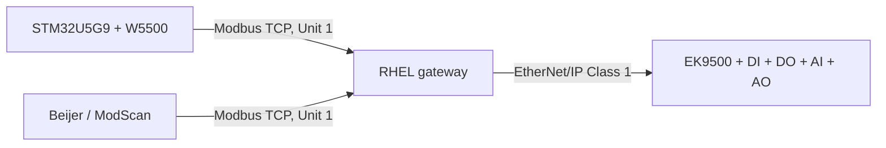

# Architecture — single Beckhoff station

The gateway owns one process image and one EtherNet/IP worker. TCP 1502 and optional TCP 502 are listener alternatives, not separate couplers. Master ACL and per-client rate limits apply to both listeners.
